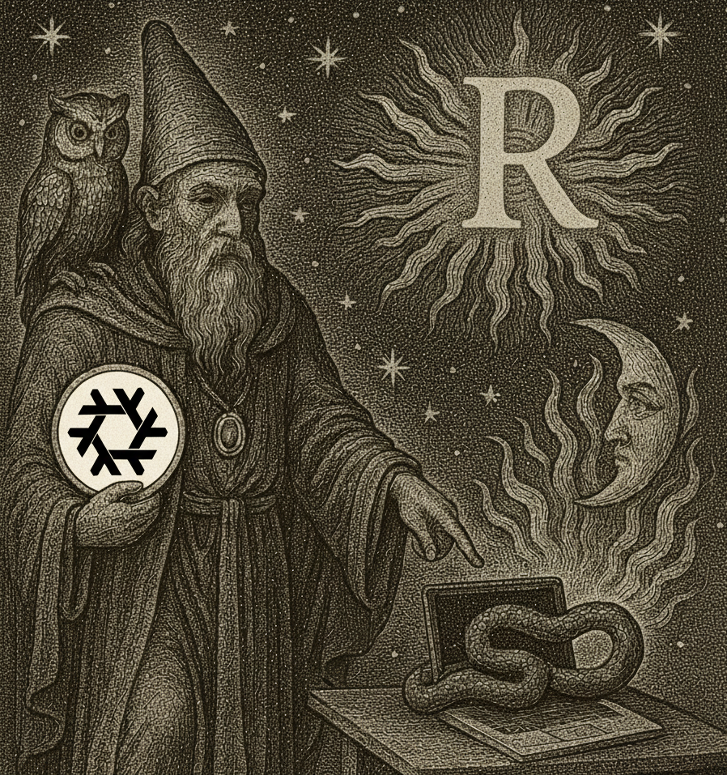
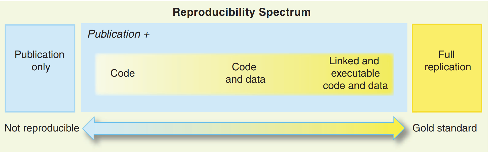

# Introduction {.unnumbered}

```{r, include = FALSE}
knitr::opts_chunk$set(tidy.opts = list(width.cutoff = 60), tidy = TRUE)
```

<div style="text-align:center;">

</div>

*This is the 2026 edition of the course. If you're looking for earlier editions,
you can find the 2024 and 2025 archives on GitHub.*

What’s new in 2026:

- **T at the center**: A modern, domain-specific language purpose-built for polyglot reproducible analytical pipelines (R, Python, and Julia).
- **Pipelines as pure function composition**: Reframing pipelines through functional programming and Directed Acyclic Graphs (DAGs).
- **Universal environment reproducibility**: Using Nix as the foundation for bit-for-bit identical, cross-language software closures.
- **AI-first workflow**: Leveraging Large Language Models (LLMs) to construct and review reproducible pipelines and tests.

*This course is based on my book [Reproducible Polyglot Data Science](https://github.com/b-rodrigues/reproducible-data-science).*

## Course Schedule

- **2026-10-30 (1.5 hours)**: Intro (Why T, the reproducibility spectrum) and Nix (environment reproducibility).
- **2026-11-11 (14:00 - 17:15, MSA 2.400)**: Building Pipelines with T (syntax, nodes, Arrow IPC serialization, DAG caching).
- **2026-11-19 (14:00 - 17:15, MSA 4.050)**: Pipelines as Function Composition (pure functions, immutability, state elimination).
- **2026-11-20 (10:15 - 11:45)**: Professional Workflows I: Testing and Test Oracles (unit testing with `{testthat}` & `pytest`, golden datasets, pipeline assertions with `testcraft`).
- **2026-11-27 (14:00 - 17:15, MSA 3.190)**: Professional Workflows II: The AI Harness & Collaborative Git (code inspection literacy for LLM traps, authoring `AGENTS.md`, closed-loop agent execution with `t test --json`, interactive Git with `git add -p`).
- **2026-12-03 (14:00 - 17:15, MNO 1.030)**: Packaging Code in R and Python for T pipelines.
- **2026-12-10 (14:00 - 17:15, MSA 3.120)**: Containerisation with Docker (spatial vs. temporal reproducibility, packaging Nix & T).
- **2026-12-16 (12:45 - 15:45, MSA 3.100)**: Continuous Integration with GitHub Actions & Course Project Wrap-up.

## What Is a Reproducible Analytical Pipeline?

This course is my take on setting up code that results in some *data product*.
This code has to be reproducible, documented, and production-ready. The term was originally
introduced by the UK's [Analysis Function](https://analysisfunction.civilservice.gov.uk/support/reproducible-analytical-pipelines/).

The basic idea of a reproducible analytical pipeline (RAP) is to have code that
always produces the exact same result when run, whatever that result might be. This is
crucial in research and science, but it is equally essential in industry and
data-driven decision-making.

A well-documented RAP eliminates technical debt, prevents "it worked on my machine"
disasters, and is readily reusable across future projects.

### What Is Reproducibility?

A project is reproducible if it can be rerun by anyone, anywhere, at any point in time,
yielding the exact same results with minimal friction.

### The Requirements of a RAP

For a project to qualify as a RAP, it must meet several strict criteria:
- **Available, version-controlled source code** (tracked with Git and GitHub);
- **Deterministic dependencies** (managed completely with Nix);
- **Non-interactive execution** (run with a single command, without manual steps in GUIs or notebooks);
- **Tested logic** (unit tests validating functions and pipeline data contracts);
- **Open-source foundation** (reproducible operating system closures via Nix and Docker).

### The Reproducibility Spectrum

Reproducibility is not binary; it exists along a continuum [@peng2011]:

::: {.content-hidden when-format="pdf"}
<figure>
    </img>
    <figcaption>The reproducibility spectrum from Peng's 2011 paper.</figcaption>
</figure>
:::

A project can control for:
1. Code only;
2. Code + language versions;
3. Code + language + package libraries;
4. Code + packages + system-level OS dependencies (Nix / Docker);
5. Hardware architecture and bit-for-bit hermetic closures.

In this course, we aim for the highest practical tier of this spectrum.

## Why T? Focusing on What Truly Matters

If you have ever tried building a data science pipeline that combines both Python and R,
you know the pain:

- In Python, you battle dependency hell across `pip`, `virtualenv`, `conda`, `poetry`, and `uv`, while wrestling with `PYTHONPATH` resolution and platform-specific wheels.
- In R, you configure `{renv}`, ensure compiler toolchains exist to compile C/C++/Fortran packages, and manage package library paths.
- To connect them, you end up writing fragile bash scripts or Makefiles, exporting ad-hoc CSV files that lose data types, and praying that everyone runs the scripts in the right order.

**Students and practitioners end up wasting 80% of their time dealing with language-specific idiosyncrasies rather than learning reproducible architecture.**

To break this cycle, this course puts **T** (`tlang`) at the center.

### A Polyglot Pipeline in T

```t
#| eval: false
p = pipeline {
  -- 1. Load data
  data = read_csv("datasets/country_level_data.csv")

  -- 2. Clean and derive in Python
  derived = pyn(
    command = <{
      derived = data.assign(
        pct_change = data["average_price_m2_nominal_euros"].pct_change() * 100
      )
    }>,
    deserializer = ^ipc,
    serializer = ^ipc
  )

  -- 3. Visualise in R
  plot = rn(
    command = <{
      library(ggplot2)
      plot <- ggplot(derived, aes(x = year, y = pct_change)) +
        geom_line() +
        theme_minimal()
    }>,
    deserializer = ^ipc
  )
}

build_pipeline(p)
```

### The Pedagogical Justification

T is an experimental domain-specific language that I began designing in 2025. While it is experimental,
placing it at the center of this course serves a vital pedagogical purpose:

1. **Focus on Reproducibility, Not Language Quirks**: T isolates the essential principles of software reproducibility:
   - **Pure Functions**: Each node is an isolated function with explicit inputs and a single output.
   - **Directed Acyclic Graphs (DAGs)**: Execution order is derived mathematically from data dependencies, not the arbitrary layout of script files or notebook cells.
   - **Hermetic Execution**: Execution takes place inside an isolated sandbox guaranteed by Nix.
   - **Content-Addressed Caching**: Only nodes whose inputs or code have changed get rebuilt.
   - **Zero-Glue Polyglot Data Exchange**: Cross-language data transfer uses standardized formats like Apache Arrow IPC (`^ipc`), passing DataFrames between Python, R, and Julia without custom serialization code.
2. **Eliminating Fragile Glue**: You no longer need to write custom glue scripts, parse command-line arguments, or track intermediate file names.
3. **Designed for the LLM Era**: T was created with a minimalist, constraint-based syntax that LLMs can generate and reason about with high precision. You can let an LLM help write the pipeline definitions, while you and the LLM focus on the R or Python data analysis code inside each node.

By abstracting execution into T and environment management into Nix, we remove the accidental complexity
of modern data science so you can master the fundamental concepts.

## Data Products and Domain Expertise

### Data Products

In this course, each of you will develop a *data product* with help from an LLM. A data product is
anything that requires data as an input and produces value: an analytical report,
a reproducible paper, an interactive dashboard, or an API. 

The focus of the course is not on the end product itself (which you can choose based on your interests),
but on the **pipeline** that builds that product reliably, reproducibly, and non-interactively.

### Machine Learning in the Age of AI

AI has fundamentally changed the game. Building a machine learning model is no longer the main 
bottleneck in data science. AI assistants can generate code, suggest architectures, debug errors, 
and accelerate experimentation. But generating code is not the same as building reliable systems.

The role of a data scientist is shifting from writing every line of code to **knowing what to build, 
how to evaluate it, and how to make it work reliably in the real world**. This requires more than 
machine learning expertise. You still need to know how to:

- **Write, test, and modularize code** — including reviewing, understanding, and validating 
  AI-generated code rather than blindly trusting it.
- **Manage environments reproducibly** — ensuring that code and dependencies behave consistently across machines and deployments.
- **Work with the command line and version control** — using tools such as Git to collaborate, 
  track changes, and maintain control over your codebase.
- **Build automated data and ML pipelines** — orchestrating workflows as reproducible, testable, and maintainable DAGs.
- **Package and deploy software** — using tools such as Docker and Continuous Integration to move from experimentation to production.
- **Validate results and challenge assumptions** — checking data quality, evaluating model performance, detecting failure modes, 
  and understanding when an apparently good result is actually wrong.

AI makes these skills more valuable, not less. The goal is no longer simply to build a model that works once. It is to build systems that are correct, reproducible, maintainable, and useful, with AI as a powerful accelerator, not a substitute for engineering judgment.

### The Importance of Domain Knowledge

Technical skills alone are not enough. Some of the greatest value you can bring as a data scientist 
comes from combining software engineering and data science with deep knowledge of a particular field, 
whether it is economics, biology, medicine, finance, or another domain.

Domain expertise helps you identify meaningful problems, understand how the underlying systems work, 
recognize when results are implausible, and distinguish useful insights from misleading correlations. 
AI can make it easier than ever to write code, build models, and explore data, but it does not automatically 
tell you which questions are worth asking or which answers matter in practice.

Your competitive advantage lies at the intersection of engineering, data science, and domain expertise. 
It is this combination that allows you to move beyond producing analyses and models to solving problems that genuinely matter.

## AI-Assisted Development

### Large Language Models and AI Coding Agents

LLMs and agentic coding workflows have transformed how software is developed. In this course, we treat LLMs as power tools:
they are highly encouraged for drafting functions, generating tests, and structuring pipelines.
However, using an LLM requires you to become a rigorous code reviewer. You will learn how to use Git's
interactive staging (`git add -p`) and automated test suites to verify that AI-generated code meets
your exact expectations before committing it.

### Setting Up an AI Agent

It is important that you have an AI coding agent installed on your computer system for this course.

When setting up your environment, consider the following options:

1. **University-provided tools**: First, check if your university provides
access to an AI coding assistant or institutional accounts (for example, through
GitHub Education / Student Developer Pack for GitHub Copilot, or campus AI
services).
2. **Personal accounts**: If you already have a personal account or subscription
to a coding agent or AI model provider (such as Claude Code, Cursor, GitHub
Copilot, or API keys for models like Claude, GPT, or Gemini), you are welcome to
use it.
3. **Freebuff**: If you do not have an institutional license or personal
subscription, you can use [Freebuff](https://freebuff.com/). Freebuff provides
free, ad-supported access to DeepSeek 4.1 for 7 hours a day, which is a very
good deal for completing your coursework.
4. **OpenCode**: Another option is [OpenCode](https://opencode.ai/), which also
provides free models. Keep in mind that free models on OpenCode typically come
with smaller context windows, and sessions might be shorter.

### Model Strategy: Strong Models for Planning and Review, Flash Models for Coding

::: {.callout-tip}
## Model Strategy: Strong Models for Planning and Review, Flash Models for Coding
When using an AI coding agent, you will get much better results by adopting a **two-tier model strategy**:

- **Strong reasoning models for planning and review**: Use a frontier model (such as Claude Sonnet, OpenAI o-series/GPT-4o, DeepSeek Reasoner, or Gemini Pro) when initially planning your pipeline architecture, structuring your `AGENTS.md`, drafting complex DAG nodes, or reviewing tricky test failures and edge cases.
- **Fast, "flash-like" models for coding and execution**: Once the plan and interface contracts are clear, switch to a quicker, lightweight model (such as Gemini Flash, Claude Haiku, or DeepSeek Flash) to generate the boilerplate code, run iterative test loops, and apply small fixes.

This split significantly reduces latency, saves daily quota, and yields cleaner results by preventing "context bloat" during fast iterative loops while reserving deep reasoning for architectural decisions.
:::

## Prerequisites

- Basic programming familiarity with R or Python (loops, functions, data structures).
- Familiarity with the command line interface (CLI).
- Linux or macOS operating system (Windows users **must** use WSL2).
- An AI coding agent installed on your computer system (see above).

## Course Project and Grading

Grading is based on your final course project. During lecture hours you will
learn each concept through live demonstrations and hands-on exercises. In
parallel, you will develop your own reproducible analytical pipeline around a
substantial analytical problem and dataset of your choice.

Because you are actively encouraged to use AI coding agents to accelerate your
development, the goal of this project is not merely to write boilerplate code.
Instead, the ambition is to tackle a **challenging, multi-language analytical
problem** and demonstrate your skills as a **harness architect, code reviewer,
and reproducibility engineer**.

### Project Scope and Ambition

To achieve a high grade, your project must meet the following specifications:

- **Polyglot Mandate**: The pipeline must integrate **at least two languages**
    (e.g., Python + R, or Python + Julia) orchestrated with T and exchanging
    data via Apache Arrow IPC (`^ipc`). Each language must be chosen
    deliberately for its strengths (e.g., Python for data scraping or machine
    learning embeddings, R for specialized statistical modeling and `{ggplot2}`
    visualization, or Julia for high-performance simulation).
- **Non-Trivial DAG Architecture**: The pipeline cannot be a single linear
    sequence of scripts. It must feature a branched Directed Acyclic Graph (DAG)
    with at least 5 distinct computation nodes (e.g., ingesting multiple data
    sources, parallel feature transformations, model fitting, and validation).
- **Pure Functions & Immutability**: All node computations must be pure
    functions with explicit inputs and outputs, free of global scope leakage,
    in-place data mutations, or unmanaged side effects.
- **The AI Harness & Test Oracles**: The repository must include a customized
    `AGENTS.md` specifying your project's negative constraints, paired with an
    automated test suite (`pytest`, `{testthat}`, or `testcraft`) anchored by
    golden reference datasets. Tests must verify analytical invariants and
    prevent LLM-generated bugs.
- **Hermetic Environment**: All dependencies (R, Python, Julia, system
    libraries, and Quarto) must be declared and pinned via a Nix flake
    (`flake.nix` and `flake.lock`).
- **Continuous Integration**: The repository must contain a GitHub Actions
    workflow that executes your test suite and builds the pipeline in a clean
    Nix environment on every push.
- **Final Data Product**: The pipeline must produce an automated, polished end
    product—such as a rendered Quarto report, an interactive dashboard, or an
    exported analytical artifact.

### Grading Rubric (20 Points)

At the end of the semester, your repository will be evaluated across four dimensions (5 points each):

| Dimension | Points | Criteria & Evaluation |
| :--- | :---: | :--- |
| **1. Polyglot Architecture & T Pipeline** | **5** | Pipeline orchestrates $\ge 2$ languages via T with Apache Arrow IPC (`^ipc`). Computation nodes are pure functions without side effects or in-place mutations. DAG caching works correctly (unchanged nodes are skipped on rebuilds). |
| **2. The AI Harness & Test Oracles** | **5** | Includes a project-specific `AGENTS.md` with explicit negative constraints. Test suite (`t test --json`, `pytest`, or `testthat`) includes rigorous test oracles / golden datasets. Code is clean and free of AI semantic traps (no silent error suppression, no float `==`, no leaky globals). |
| **3. Deterministic Environment & CI** | **5** | Dependencies are declared in `flake.nix` and pinned in `flake.lock`. A GitHub Actions workflow passes cleanly on every push, building and testing the project non-interactively without manual intervention. |
| **4. Problem Complexity & Data Product** | **5** | Tackles a non-trivial, interesting analytical question. Produces a polished final data product (e.g., Quarto document). Repository has an exemplary `README.md` explaining the DAG architecture, data flow, and instructions to reproduce. |

### Evaluation Protocol

Your repository will be evaluated objectively and non-interactively:

1. **The "One-Command" Test**: I’ll clone your repository and runs the Nix build
command (or verifies the green status of your GitHub Actions CI). If the
pipeline fails to build from scratch or requires imperative manual steps, marks
are deducted immediately.
2. **Harness & Oracle Inspection**: The instructor reviews your `AGENTS.md` and
test suite to verify that your test assertions are genuine analytical oracles
rather than trivial tautologies.
3. **Diff & Code Quality Review**: The instructor reviews the code inside your
pipeline nodes to verify that functions are pure, properly scoped, and that
AI-generated artifacts have been rigorously audited.

## Jargon

### T
- **T (`tlang`)**: A domain-specific language for defining reproducible analytical pipelines across R, Python, and Julia.
- **Node**: A single computation step in a pipeline. Nodes act as pure functions: they take explicit inputs and produce a single serialized artifact.
- **`rn()` / `pyn()` / `jln()`**: T node constructors for R, Python, and Julia runtimes.
- **Serializer / Deserializer**: The mechanism T uses to write and read node outputs (e.g., `^ipc` for Apache Arrow, `^csv`, `^parquet`, `^rds`).
- **Pipeline (`pipeline { ... }`)**: A declarative block that defines the DAG of nodes and their data dependencies.
- **`build_pipeline()`**: The function that compiles the DAG, checks the cache, and executes stale nodes in dependency order.
- **`read_node()`**: A function used to inspect the cached output of a specific node interactively.

### Nix
- **Nixpkgs**: The central repository of over 120,000 packages used by Nix.
- **Derivation**: A low-level, cryptographic build instruction in Nix.
- **Nix Store (`/nix/store`)**: The read-only directory where all isolated packages and build artifacts reside.
- **Hermetic Sandbox**: An isolated build environment with no network access or hidden system dependencies.
- **Binary Cache**: Pre-built packages identified by cryptographic hash (e.g. Cachix or `cache.nixos.org`), avoiding redundant local compilation.

## Further Reading

- [Reproducible Polyglot Data Science](https://github.com/b-rodrigues/reproducible-data-science)
- [T Language Repository](https://github.com/b-rodrigues/tlang)
- [Building Reproducible Analytical Pipelines with R](https://raps-with-r.dev/)
- [How Nix Works](https://nixos.org/guides/how-nix-works/)

## License

This course is licensed under the [WTFPL](http://www.wtfpl.net/txt/copying/).

<a href="http://www.wtfpl.net/"></a>
